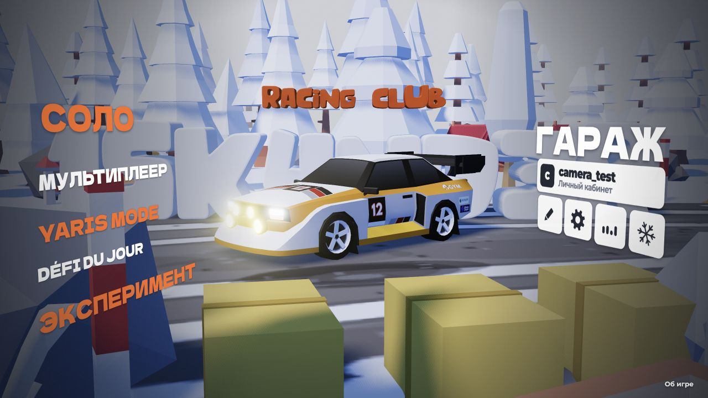
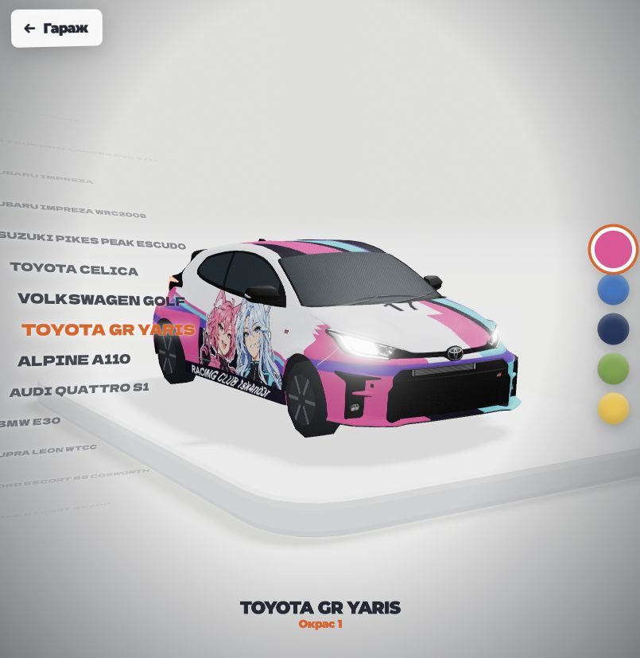
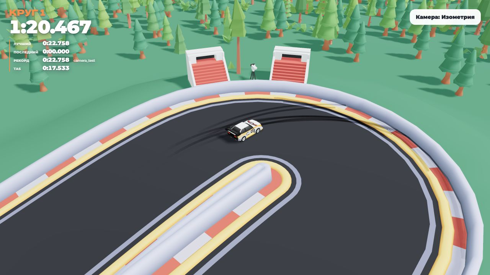
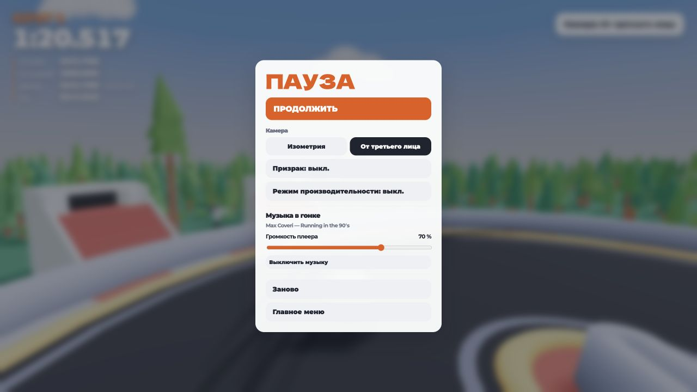
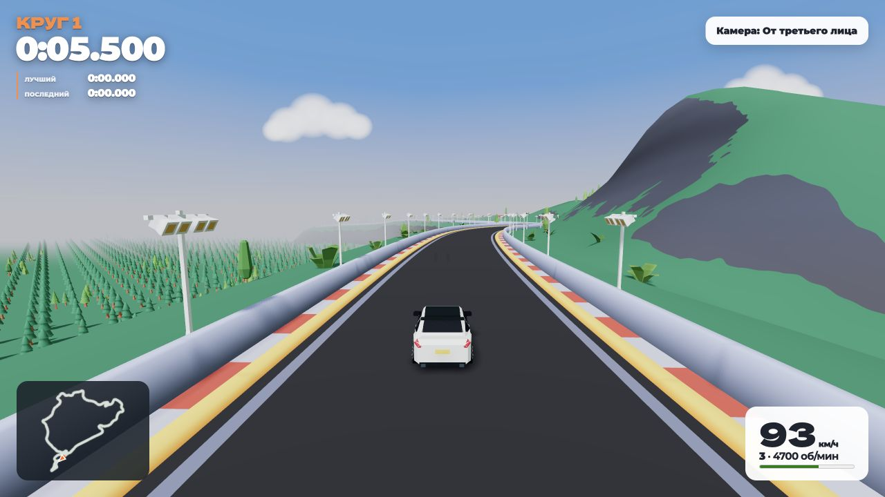
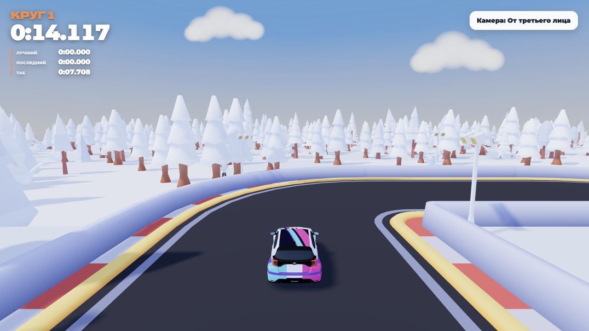

# Racing Club 1sk4nd3r

Версия [DirtBound](https://dirtbound.fr/index.html): Go-сервер, PostgreSQL, управление автомобилем на Go → WebAssembly и исходный 3D-клиент. Снимок клиента — 31 октября 2026 года. Репозиторий: `lciga/dirtbound-go`.

## Скриншоты

| Главное меню | Гараж — Toyota GR Yaris |
| --- | --- |
|  |  |
| **Кольцевая гонка — изометрия** | **Музыка в меню паузы** |
|  |  |

Бета: трансмиссия, спидометр и карта трассы.





## Запуск Docker Compose

Нужны Docker и Compose с поддержкой `--wait`, а также Python 3 для однократного создания `.env`. Go и Node.js на хосте для запуска не нужны.

```sh
git clone https://github.com/lciga/dirtbound-go.git
cd dirtbound-go
python3 tools/init-env.py
docker compose up -d --build --wait
```

Открыть <http://localhost:8080/>: сразу игровое 3D-меню. Каталог и рейтинги доступны в выборе трассы; личный кабинет открывается по нажатию на имя игрока. Отдельной главной страницы нет; прежние ссылки `/site.html` ведут в меню. Регистрация — по логину и паролю; Google OAuth не используется. Гостю доступны сайт, каталог и рейтинги; заезды требуют входа, включая прямые ссылки на `/play.html`.

`tools/init-env.py` создаёт `.env` со случайным паролем PostgreSQL и правами `0600`, сохраняет существующие настройки. `.env` исключён из Git и контекста Docker. Порт и адрес привязки меняются в нём; по умолчанию доступ только с этого компьютера. PostgreSQL не публикует порт наружу. Для доступа через интернет нужен HTTPS на внешнем reverse proxy.

```sh
docker compose ps
docker compose logs -f dirtbound
docker compose down
# Обновление с сохранением данных:
git pull
python3 tools/init-env.py
docker compose up -d --build --wait
# Другой локальный порт:
PORT=8090 docker compose up -d --wait
```

Go-приложение работает без root, с файловой системой только для чтения. Проверка `/healthz` проверяет также доступность БД. Приложение ждёт здоровую PostgreSQL при запуске.

## Данные и перенос прежней версии

**Единственное активное серверное хранилище — PostgreSQL 18**, именованный том `<compose-project>_pgdata`. Отдельные таблицы: аккаунты, хеши паролей, сессии, опубликованные трассы, звёзды, лучшие круги и призраки. Индексы ускоряют каталог, рейтинг и выборку личных результатов. Сохранение лучшего круга выполняется атомарно: параллельный медленный круг не перезаписывает быстрый.

Прежний том `<compose-project>_data` подключается только для чтения. Если в `/data/store.json` найдена старая база, первый запуск переносит её **одной транзакцией** вместе с хешами паролей и действующими сессиями. Исходный JSON остаётся резервной копией и больше не обновляется. Маркер и SHA-256 импорта предотвращают повторный перенос. При повреждённых данных транзакция откатывается; если в БД уже есть данные игроков без маркера импорта, автоматическое объединение запрещено.

При обновлении существующей установки **сохраните имя Compose-проекта**, чтобы использовать прежний том. Например, для текущего локального стенда:

```sh
PORT=18081 docker compose -p dirtbound-camera-check up -d --build --wait
```

`docker compose down` и пересоздание контейнеров сохраняют данные. **`docker compose down -v` удаляет тома вместе с БД и прежней JSON-копией.** Не используйте его для обновления.

Локальные настройки, черновики редактора и копии личных рекордов остаются в браузере. Они не превращаются в серверные записи автоматически. Опубликованные трассы и отправленные лучшие круги доступны с другого устройства. Личный кабинет показывает статистику, последние 50 личных рекордов, позволяет сменить отображаемое имя и управлять опубликованными трассами. Админ-панель и почтовое восстановление пароля не реализованы.

```sh
# Сохранить сжатую резервную копию PostgreSQL в backups/ (не входит в Git):
./tools/backup.sh
# Для нестандартного Compose-проекта:
COMPOSE_PROJECT_NAME=dirtbound-camera-check ./tools/backup.sh
# Проверить оглавление копии:
docker compose exec -T postgres pg_restore --list < backups/ИМЯ.dump
```

Формат копии — `pg_dump -Fc`. Восстановление следует проверять в отдельной пустой БД через `pg_restore --exit-on-error`, до переключения приложения. Автоматический Compose-тест действительно восстанавливает копию в отдельную тестовую БД и проверяет аккаунт. Регулярное внешнее хранение копий настраивается владельцем установки.

## Игра и каталог

- Изометрическая и камера от третьего лица, переключение C; выбор сохраняется. Сезон одинаков в меню, кольцевой гонке и ралли.
- Кольцевые трассы, процедурные спецучастки, ежедневный заезд, редактор, гараж и комнаты до 8 игроков.
- 9 готовых опубликованных трасс плюс базовая Kenney. Добавлены Spa-Francorchamps, Monaco, Nordschleife, Mountain Circuit, Drift Rally Track, Bridges Meadow. Именованные автодромы — **пользовательские адаптации из каталога оригинала**, не точные официальные модели. Авторы и источники — в `NOTICE.md`.
- В карточках выбора режима вместо отсутствующих MP4 используются локальные превью; размер надписи рассчитывается по фактической ширине текста, включая кириллицу.
- Машина заблокирована до завершения отсчёта. Бёрнаут возможен только короткое время после GO, не при следующем пересечении старта.
- Поддерживающая дорога не исчезает при прозрачности перекрывающего моста. Звук ударов об отбойник отключён.
- Серии записанных отстрелов Audi R8, паузы 6–12 секунд на отсечке, набор давления и сброс турбины; двигатель и шины приглушены. Источник звуков и обработка — `NOTICE.md`. Пользовательская картинка с ливрей удалена.

## Производительность

Профиль, личные рекорды и опубликованные трассы встроены в игровое меню в оформлении настроек. Данные кабинета загружаются только при его открытии или обновлении. Каталог имеет серверную пагинацию (до 100 элементов на запрос, в кабинете — 8); SQL не читает полный рельеф для карточек, а рейтинг не читает призраки. Хранилище больше не блокирует все запросы общей блокировкой и не переписывает JSON целиком при каждом рекорде. Пул PostgreSQL ограничен 12 соединениями; дорогое хеширование паролей — 4 одновременными операциями.

Текстовые ресурсы и WebAssembly сжимаются gzip при сборке; сервер учитывает `Accept-Encoding`, `ETag`, условные GET, HEAD и Range. Неверсионированные файлы проверяются по ETag при повторной загрузке, поэтому изменения не застревают в кеше. API и авторизованная страница гонки имеют `no-store`. В сборке до разбиения трасс 579 ресурсов занимают около 21.3 МБ исходно и 5.7 МБ в gzip; это размер ресурсов, а не размер всей игры или одной загрузки.

После первого посещения service worker сохраняет статические ресурсы по списку ETag сборки и отдаёт их без повторных сетевых запросов. Новая сборка обновляет этот список и сохраняет только неизменившиеся файлы. HTML, API, WebSocket и потоковая музыка продолжают обращаться к серверу; проверка входа и бета-доступа не кешируется.

Пул дыма остаётся фиксированным: на видеокарту отправляются только живые экземпляры, при отсутствии дыма нет обновлений матриц. На низкой графике пропускается построение сетки непрямого освещения из множества кубических карт; сохраняется базовое освещение сцены. Действующие адаптивное разрешение, пакетная отрисовка леса и 120 Гц физики сохранены. WASM компилируется потоково при поддержке браузером.

Проверялся вариант пакетной передачи результатов Go → JS; микробенчмарк не показал существенного ускорения, поэтому текущий обмен оставлен. `node tools/bench-wasm.mjs [путь-к-базовому.wasm]` измеряет только вызовы WASM. `?debug` в игре выводит время длинных кадров по компонентам. Эти измерения не доказывают прирост FPS: производительность зависит от сцены, видеокарты, разрешения и пресета.

## Тяжёлые трассы и локальная музыка

Nordschleife и остальные 8 опубликованных трасс входят в `npm run test:performance`. Тест сравнивает каждую вершину треугольников, нормаль и вес материала рельефа до и после разбиения, проверяет количество дорожных треугольников и детерминированное ограничение леса.

Рельеф разбит на индексированные участки 64 м: участки вне камеры отсекаются. На Nordschleife это сокращает хранение вершин с 1 195 332 до 214 662 при сохранении всех треугольников. Дорога без мостов также разбивается на участки; мостовые трассы сохраняют прежний механизм прозрачности. Лес и декоративные плитки разделены на пространственные группы; лес ограничен 1200 ячейками на трассу. Расчёт непрямого освещения ограничен 32 кубическими картами, а на трассах длиннее 1200 м или с более чем 48 чанками рельефа используется базовое освещение. Построение окружения отдаёт управление браузеру между этапами. Это уменьшает объём работы, но не гарантирует одинаковый FPS на всех видеокартах.

`?debug` пишет `[circuit-ready]` со временем загрузки и числом участков/ячеек леса, а `[circuit-performance]` — среднее и 95-й процентиль времени 120 кадров, время JavaScript, число вызовов отрисовки и треугольников. Счётчик включает постобработку; замеры из скрытых вкладок исключаются. Результаты проверочного браузера сохраняются отдельно и не являются гарантией FPS на другом устройстве.

Предварительная компиляция каждого набора шейдеров ограничена 2,5 секунды. Если драйвер не завершает её вовремя, заезд не ждёт бесконечно: необязательное запекание освещения пропускается, а основные шейдеры заканчивают компиляцию при обычной отрисовке.

Все 13 согласованных песен подключены к локальному плейлисту меню; список сохранён в `web/audio/music/club-approved.json`. В меню и обычных гонках песни перемешиваются на каждый проход плейлиста: все 13 играют по одному разу, без повтора на границе двух проходов. Yaris Mode зацикливает только Niko B — Why’s This Dealer? (Guy Arthur Remix). Аудиодорожки с YouTube сохранены в AAC/M4A без видео и включены в репозиторий и Docker-образ. Для Celldweller — One Good Reason (Instrumental) пользователь отдельно согласовал публикацию NFS Music. Ссылки и сведения об источниках находятся в `NOTICE.md`.

```sh
python3 tools/import-menu-music.py /путь/к/аудиофайлам
# После импорта пересобрать образ:
docker compose up -d --build --wait
```

Импортёр сопоставляет названия с утверждённым списком, копирует только найденные файлы и формирует `web/audio/music/club/manifest.json`. Имена можно привести к `id` из согласованного списка. Пользовательские аудиофайлы исключены из Git, кроме явно включённых 13 согласованных записей. Их общий размер — около 50 МиБ. Воспроизводится один файл за раз; плейлист с новыми песнями загружается только в меню, внешние музыкальные сервисы не вызываются. При пустом плейлисте сохраняется прежняя музыка меню.

## Yaris Mode, гараж и бета

Toyota GR Yaris доступна в гараже в пяти гоночных окрасах. Упрощённая модель согласована с раллийным набором: 2 700 треугольников, около 159 КБ, шесть вызовов отрисовки без внешних текстур. В обычном заезде она не деформируется. Yaris Mode теперь включается переключателем при создании сетевой гонки или выборе соло-заезда; его можно сочетать с бетой. Сервер назначает Yaris всем игрокам такой комнаты. Только этот переключатель включает растяжение модели и Why’s This Dealer? (Guy Arthur Remix). У обычного Yaris в гараже и гонке общий плейлист.

Смена машины в гараже сразу отправляется в открытую комнату и сбрасывает готовность. Для Yaris учитывается весь кузов при контакте с отбойником, включая максимальное визуальное растяжение; основная физическая сфера по-прежнему отвечает за землю. Дополнительная проверка просматривает ближайшие сегменты стен через пространственный индекс, а не всю трассу. Короткие звуки входа и выхода участников работают во всех сетевых режимах; первый снимок комнаты, готовность и обычное переподключение страницы не дают ложных сигналов.

**Доступ к бете:** `python3 tools/init-env.py` генерирует общий `BETA_TESTER_CODE` в локальном `.env`. Код не печатается и не попадает в Git. После пересборки владелец передаёт его тестерам; поле ввода находится в личном кабинете. Поле `beta_access` добавляется номерной миграцией `internal/server/migrations/002_beta_access.sql` при запуске Go-сервера, в транзакции под advisory lock. Уже выполненная версия пропускается. Обновление существующей БД не требует удаления томов. Успешная активация навсегда сохраняется за аккаунтом в PostgreSQL и показывает отдельный бета-раздел с соло и сетевыми комнатами. Сервер проверяет доступ при создании и входе в бета-комнаты, а также по прямой ссылке `play.html?beta=1`. Замена кода в `.env` закрывает старый код для новых активаций и сохраняет уже выданные доступы.

В бете включена экспериментальная пятиступенчатая автоматическая трансмиссия на Go/WASM: передаточные числа, кривая момента, главная пара, краткий разрыв тяги при переключении, торможение двигателем, тормоза и задний ход. Тяга меняет фактическую скорость физического тела. Спидометр рассчитывается по его скорости, карта трассы использует не более 256 точек и кеширует полотно; HUD обновляется 10 раз в секунду. Результаты беты отделены от обычных локальных рекордов и не отправляются в обычный рейтинг. Это экспериментальная модель поверх аркадной физики контактов, без полноценной симуляции каждого колеса и сцепления.

Обновлённая бета использует единый масштаб: 1 единица мира = 2 м, скорость — по фактическому движению тела, 10 км спецучастка — 5 000 единиц мира. Тяга и тормоза направлены по плоскости дороги, боковое сцепление рассчитывается отдельно от контакта физической сферы. Исправлены возврат из R, трогание после остановки на высокой передаче и потеря скорости на переменном рельефе. R имеет отдельный ограничитель около 36 км/ч. Силы шин не действуют в воздухе. Убрано скрытое ограничение скорости вращения сферы около 170 км/ч.

В бете генерируемые спецучастки получают более длинные разгоны и радиусы поворотов в шесть раз больше; ширина дороги и выбранная дистанция сохраняются. Обычные маршруты сохраняют прежнюю геометрию. Финиш беты привязан к выбранной дистанции, локальные результаты новой физики используют пространство `beta-v3`. Контрольные 10 км проходят за **3:23–3:50**; методика и границы проверки — [в отчёте](docs/beta-physics.md).

Проекции GR Yaris, размеры, сравнение с четырьмя моделями набора и обязательные правила для следующих машин собраны в [руководстве по стилю](docs/vehicle-style.md).

Обычные заезды сохраняют прежние формулы управления. Их пятиступенчатая звуковая коробка переключает передачи при разгоне и держит крейсерские обороты ниже непрерывной отсечки. В меню и гонке отдельные уровни музыки; громкость гонки также сохраняется из паузы. Согласованный плейлист перемешивается, Yaris Mode играет только свою песню. Билборды используют предоставленную пользователем картинку `web/images/club-billboard.jpg`.

Русский словарь полностью покрывает исходные подписи и служит запасным переводом. Французский больше не выбирается по старой настройке браузера или ссылке. Начальная HTML-разметка, ежедневные испытания, лобби, редактор и проверка бонусов переведены; полноту ключей и параметры подстановки проверяет `test:localization`.

Старые контакты и сведения о прежних издателях убраны из интерфейса. Лицензии библиотек и происхождение заимствованных материалов сохранены в `NOTICE.md` и экране сторонних ресурсов.

## Границы переноса

Это **гибридный порт**. Go/WASM рассчитывает разгон, торможение, задний ход, инерцию поворота, ручник, бездорожье, буст и занос. Three.js, сцены, интерфейс и Crashcat (контакты, гравитация, движение физической сферы) остаются JavaScript. Численное совпадение управления подтверждается сравнением с оригинальным Vehicle.js.

Полного исходного репозитория и закрытого сервера DirtBound нет: использованы публичные файлы, отдаваемые браузеру. Независимый Go-сервер реализован по клиентскому протоколу. Аккаунты и рекорды оригинального сервера не копировались. Лицензии и происхождение ресурсов сохранены в `NOTICE.md`; единой открытой лицензии на весь проект нет.

Пароли: PBKDF2-HMAC-SHA256, 600 000 итераций, случайная соль. Сессия: случайный токен, на сервере только его SHA-256, cookie HttpOnly/SameSite, срок 30 дней, отзыв при выходе. Есть ограничение попыток входа. Данные аккаунта и хеши не отдаются каталогом или рейтингами.

Рейтинг проверяет формат, длительность и предельную скорость призрака, но не выполняет полный серверный пересчёт круга и античит оригинала. Архив непобедных кругов отключён. Сетевые комнаты и движущиеся игроки живут в памяти одного Go-процесса и теряются при рестарте; PostgreSQL сохраняет постоянные данные, но не превращает комнаты в распределённый мультиплеер. Случайная кольцевая гонка в голосовании выбирает Kenney.

## Проверка и локальная разработка

Go 1.27, Node.js 20+, Python 3.9+, Docker для интеграционных тестов:

```sh
npm ci --ignore-scripts --no-audit --no-fund
./tools/build.sh
python3 tools/test-postgres.py
npm run test:parity
npm run test:race-start
npm run test:customization
npm run test:catalog
npm run test:yaris
npm run test:beta
npm run test:beta-physics
npm run bench:beta-route
npm run test:localization
npm run test:performance
npm run test:assets
python3 tools/test-compose.py
```

`test:beta-physics` запускает настоящий Go/WASM вместе с `Vehicle` и контактным движком Crashcat: подъёмы, R ↔ вперёд, тормоза, ручник, бездорожье, движение в воздухе, боковое скольжение и разные шаги физики. `bench:beta-route` проезжает три 10-километровых маршрута автоматическим водителем с рельефом из `RallyStage`, без отрисовки и декораций. Это проверка темпа и устойчивости, а не FPS или гарантия времени для любого игрока. Перед запуском нужен актуальный `./tools/build.sh`.

`test-postgres.py` создаёт временную PostgreSQL 18, запускает `go test -race ./...` с изолированными схемами и удаляет только свой тестовый контейнер. Проверяются перенос JSON, сохранение паролей и сессий, откат неудачного импорта, идемпотентность, параллельные рекорды, профиль, права доступа и WebSocket. Отдельный тест обновляет прежнюю схему миграцией 002, сохраняет старый аккаунт и сессию, активирует бету и повторяет запуск. Без `TEST_DATABASE_URL` серверные интеграционные тесты явно пропускаются; файловые/численные тесты работают отдельно.

`test-compose.py` собирает и запускает отдельный случайный проект, проверяет страницы, 9 трасс, пагинацию, авторизацию, WASM, модели, WebSocket, резервную копию и сохранение профиля, сессии и бета-доступа после пересоздания **обоих** контейнеров. Миграция 002 должна оставаться выполненной ровно один раз. Удаляются только его тестовые тома. `--no-build` использует готовый образ.

Проверка WASM: 504 000 сравнений с исходными формулами, максимальная абсолютная ошибка примерно `1.7e-10`. Тесты клиента дополнительно проверяют сезоны, звук, отсчёт, бёрнаут, дым, геометрию логотипа и всех 9 готовых трасс. Это не субъективная оценка звука и не замер игрового FPS.

Для запуска нативного Go-сервера вне Compose задайте `DATABASE_URL` своей PostgreSQL и выполните `./bin/dirtbound -addr 127.0.0.1:8080 -data data`. Миграции выполняются транзакционно при старте. Шаблон CI — `tools/ci-template.yml`; активный workflow не установлен, поскольку текущее разрешение GitHub не включает запись workflows.
