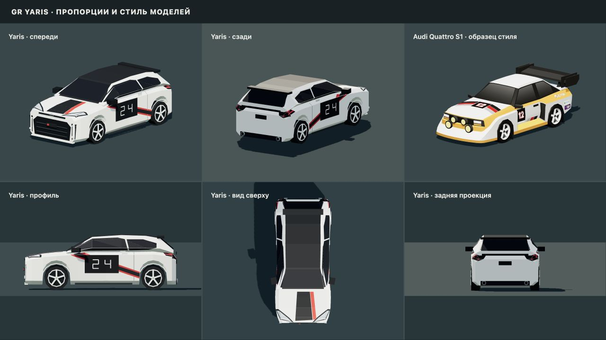

# Проверка беты: трансмиссия, скорость и GR Yaris

Проверка 2 ноября 2026 года. Ориентир пользователя: аркадный темп 3–4 минуты на 10 км. Изменения движения ограничены бетой; звуковая коробка обычного режима также стала пятиступенчатой.

## Изменения

- Пять передач вперёд, отдельный устойчивый диапазон R. Смена направления сначала тормозит всю машину, включая боковое скольжение. Остановка на высокой передаче сразу возвращает первую.
- Тяга, тормоза и боковое сцепление действуют в плоскости дороги и только при контакте с землёй. У физической сферы беты отключена вторая, конфликтующая модель трения; обычный режим сохраняет прежнее трение и управление.
- Исправлен масштаб гравитации для мира половинного размера; сила тяжести не прибавляется повторно в трансмиссии. Задний ход ограничивается и на спуске. Убран прежний предел вращения сферы, ограничивавший скорость примерно 170 км/ч.
- Шкала беты: 2 м на единицу мира. 10 км маршрута = 5 000 единиц по осевой линии, спидометр использует полную скорость физического тела. Финиш и одометр согласованы с этой шкалой. Уклоны немного увеличивают фактический трёхмерный путь относительно горизонтальной осевой линии.
- Только у генерируемых спецучастков беты радиусы и длины элементов увеличены в шесть раз, ширина дороги сохраняется. Это даёт место быстрому разгону и прохождению поворотов. Обычные семена трасс сохраняют прежнюю геометрию. Новая физика использует отдельные локальные рекорды `beta-v2`.

## Контрольный проезд 10 км

`npm run bench:beta-route` запускает актуальный Go/WASM, настоящий `Vehicle`, физическое тело и Crashcat. Маршрут создаётся `RallyRoute`; высоты и уклоны берутся из той же функции, что в `RallyStage.buildNext`. Автоматический водитель учитывает повороты, тормозной путь и гребни. Он не меняет координаты автомобиля напрямую. Заезд прекращается при выходе за дорожную полосу с запасом под кузов.

| Семя | Рельеф | Время | Средняя скорость | Максимальная скорость | Отклонение от оси, максимум |
| --- | --- | ---: | ---: | ---: | ---: |
| 152428 | низкий | 3:22,33 | 177,9 км/ч | 227,1 км/ч | 0,28 м |
| 19381 | смешанный | 3:46,97 | 158,6 км/ч | 229,2 км/ч | 0,29 м |
| 2026 | горный | 3:45,33 | 159,7 км/ч | 226,0 км/ч | 0,29 м |

[Исходный машинный отчёт](beta-route-benchmark.json).

Дистанция каждого измерения — около 9 999 м; допуск остановки измерителя менее метра. Во всех трёх проездах достигнута пятая передача. Повторить и сохранить машинный отчёт можно так:

```sh
./tools/build.sh
BETA_BENCH_REPORT=/tmp/beta-route.json npm run bench:beta-route
```

Это воспроизводимая проверка темпа силовой установки и контактов на осевой линии. Она не включает деревья, зрителей, ограждения, графику, сеть, ошибки человека и выбор иной траектории; время конкретного игрока будет другим. Показания не являются замером FPS.

## Автоматические проверки

| Область | Проверка | Результат |
| --- | --- | --- |
| Go/WASM + реальные контакты | Трогание на 0, 10, 18 и 30%; повторные R ↔ вперёд на ровной дороге и 18%; остановка на пятой; откат; ручник; тормоза; бездорожье; отсутствие тяги в воздухе; боковое скольжение; переменный уклон; 60/120/240 шагов; смешанные действия 45 с, направления сенсорного джойстика | 15 проверок, пройдены |
| Генерация | 15 сочетаний семени/рельефа: ровно 10 км, постепенная генерация совпадает с полной, ограниченное число узлов; прежний масштаб обычных маршрутов | 2 проверки, пройдены |
| Весь клиент | Физика, геометрия 9 трасс, Yaris, карта, отсчёт, бёрнаут, сезоны, звук, перевод | 66 проверок, пройдены |
| Обычная физика | 36 000 шагов, 504 000 сравнений с прежними формулами | Максимальная абсолютная ошибка 1,66 × 10⁻¹⁰ |
| Go + PostgreSQL 18 | `go test -race ./...` на временной БД | Пройдено; гонок данных не обнаружено |
| Онлайн-бета | Два тестера, запрет доступа без кода, загрузка обоих, отсчёт и запрет раннего финиша, Yaris у всех, переподключение, обмен состояниями, два результата | Пройдено |
| Миграция | Старая схема → 002, сохранение аккаунта/сессии, активация беты, повторный запуск | Пройдено |
| Docker Compose | Отдельный проект, авторизация, WASM, модели, WebSocket, бэкап/восстановление, пересоздание обоих контейнеров | Пройдено; аккаунт, сессия и бета сохранены, миграция выполнена один раз |

## Проверка в браузере

Проверена собранная Docker-версия на локальном стенде с тестовым аккаунтом. Все девять готовых трасс загрузились и приняли управление Yaris; ошибок JavaScript при этих проверках не было. Это проверка старта и движения, а не полный ручной круг на каждой трассе.

| Трасса | Наблюдавшаяся загрузка до готовности |
| --- | ---: |
| Стройка | 3,15 с |
| Речной пирог | 3,12 с |
| Олуфсен | 3,27 с |
| Spa-Francorchamps | 3,43 с |
| Монако | 3,28 с |
| Nürburgring Nordschleife | 11,91 с |
| Горная трасса | 4,96 с |
| Drift Rally Track | 3,49 с |
| Bridges Meadow | 3,38 с |

Время зависит от компьютера, шейдеров, кеша и одновременных сцен. У Nordschleife отключено дорогое запекание проб, лес ограничен 1 200 ячейками вместо 12 506 кандидатов; дорога и земля разбиты на части для отсечения невидимого. Загрузка завершается, но почти 12 секунд на этом стенде остаются заметной задержкой. Перечисленные результаты не доказывают стабильные 60 FPS на других устройствах.

Дополнительно проверены R → вперёд (36 км/ч назад → 102 км/ч вперёд за пять секунд газа), обе камеры, пять окрасов в гараже, пауза, музыка и ползунок гонки, горный спецучасток 10 км (0,12 км и 121 км/ч примерно за 5,6 с разгона). Геометрия Yaris проверена с нескольких сторон рядом с Audi набора; правила и источники находятся в [руководстве по моделям](vehicle-style.md).


