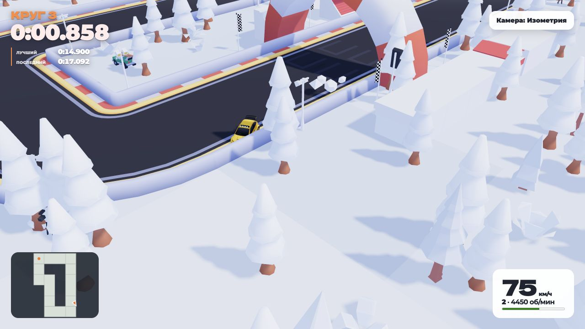

# Проверка беты: трансмиссия, скорость и GR Yaris

Первичная проверка 2 ноября, повторная проверка управления 3 ноября 2026 года. Ориентир пользователя: аркадный темп 3–4 минуты на 10 км. Изменения движения ограничены бетой; звуковая коробка обычного режима также стала пятиступенчатой.

## Изменения

- Пять передач вперёд, отдельный устойчивый диапазон R. Смена направления сначала тормозит всю машину, включая боковое скольжение. Остановка на высокой передаче сразу возвращает первую.
- Тяга, тормоза и боковое сцепление действуют в плоскости дороги и только при контакте с землёй. У физической сферы беты отключена вторая, конфликтующая модель трения; обычный режим сохраняет прежнее трение и управление.
- Исправлен масштаб гравитации для мира половинного размера; сила тяжести не прибавляется повторно в трансмиссии. Задний ход ограничивается и на спуске. Убран прежний предел вращения сферы, ограничивавший скорость примерно 170 км/ч.
- Шкала беты: 2 м на единицу мира. 10 км маршрута = 5 000 единиц по осевой линии, спидометр использует полную скорость физического тела. Финиш и одометр согласованы с этой шкалой. Уклоны немного увеличивают фактический трёхмерный путь относительно горизонтальной осевой линии.
- Только у генерируемых спецучастков беты радиусы и длины элементов увеличены в шесть раз, ширина дороги сохраняется. Это даёт место быстрому разгону и прохождению поворотов. Обычные семена трасс сохраняют прежнюю геометрию. Новая физика использует отдельные локальные рекорды `beta-v4`.

## Контрольный проезд 10 км

Результаты повторно измерены 3 ноября после коррекции радиуса поворота.

`npm run bench:beta-route` запускает актуальный Go/WASM, настоящий `Vehicle`, физическое тело и Crashcat. Маршрут создаётся `RallyRoute`; высоты и уклоны берутся из той же функции, что в `RallyStage.buildNext`. Автоматический водитель учитывает повороты, тормозной путь и гребни. Он не меняет координаты автомобиля напрямую. Заезд прекращается при выходе за дорожную полосу с запасом под кузов.

| Семя | Рельеф | Время | Средняя скорость | Максимальная скорость | Отклонение от оси, максимум |
| --- | --- | ---: | ---: | ---: | ---: |
| 152428 | низкий | 3:21,64 | 178,5 км/ч | 227,1 км/ч | 0,76 м |
| 19381 | смешанный | 3:46,91 | 158,6 км/ч | 229,2 км/ч | 0,74 м |
| 2026 | горный | 3:46,68 | 158,8 км/ч | 226,6 км/ч | 0,75 м |

[Исходный машинный отчёт](beta-route-benchmark.json).

Дистанция каждого измерения — около 9 999 м; допуск остановки измерителя менее метра. Во всех трёх проездах достигнута пятая передача. Повторить и сохранить машинный отчёт можно так:

```sh
./tools/build.sh
BETA_BENCH_REPORT=/tmp/beta-route.json npm run bench:beta-route
```

Это воспроизводимая проверка темпа силовой установки и контактов на осевой линии. Она не включает деревья, зрителей, ограждения, графику, сеть, ошибки человека и выбор иной траектории; время конкретного игрока будет другим. Показания не являются замером FPS.

## Автоматические проверки

Физика, генерация, Go-пакет автомобиля, бета-коллизии и целостность ресурсов повторно проверены 3 ноября. Остальные строки сохраняют результаты полной проверки 2 ноября; сервер и схема БД в текущей правке не менялись.

| Область | Проверка | Результат |
| --- | --- | --- |
| Go/WASM + реальные контакты | Трогание на 0, 10, 18 и 30%; повторные R ↔ вперёд на ровной дороге и 18%; остановка на пятой; откат; ручник; тормоза; бездорожье; отсутствие тяги в воздухе; боковое скольжение; переменный уклон; 60/120/240 шагов; смешанные действия 45 с, направления сенсорного джойстика; фактический радиус, контрруление и симметрия поворотов | 21 проверка, пройдена 3 ноября |
| Генерация | 15 сочетаний семени/рельефа: ровно 10 км, постепенная генерация совпадает с полной, ограниченное число узлов; прежний масштаб обычных маршрутов | 2 проверки, пройдены |
| Весь клиент | Физика, геометрия 9 трасс, Yaris, карта, отсчёт, бёрнаут, сезоны, звук, перевод | 69 проверок, пройдены |
| Обычная физика | 36 000 шагов, 504 000 сравнений с прежними формулами | Максимальная абсолютная ошибка 1,66 × 10⁻¹⁰ |
| Go + PostgreSQL 18 | `go test -race ./...` на временной БД | Пройдено; гонок данных не обнаружено |
| Онлайн-бета | Два тестера, запрет доступа без кода, загрузка обоих, отсчёт и запрет раннего финиша, Yaris у всех, переподключение, обмен состояниями, два результата | Пройдено |
| Миграция | Старая схема → 002, сохранение аккаунта/сессии, активация беты, повторный запуск | Пройдено |
| Docker Compose | Отдельный проект, авторизация, WASM, модели, WebSocket, бэкап/восстановление, пересоздание обоих контейнеров | Пройдено; аккаунт, сессия и бета сохранены, миграция выполнена один раз |

## Проверка в браузере

Проверена собранная Docker-версия на локальном стенде с тестовым аккаунтом. Все девять готовых трасс загрузились и приняли управление Yaris; ошибок JavaScript при этих проверках не было. Это проверка старта и движения, а не полный ручной круг на каждой трассе.

| Трасса | Наблюдавшаяся загрузка до готовности |
| --- | ---: |
| Стройка | 3,15 с |
| Речной пирог | 3,12 с |
| Олуфсен | 3,27 с |
| Spa-Francorchamps | 3,43 с |
| Монако | 3,28 с |
| Nürburgring Nordschleife | 11,91 с |
| Горная трасса | 4,96 с |
| Drift Rally Track | 3,49 с |
| Bridges Meadow | 3,38 с |

Время зависит от компьютера, шейдеров, кеша и одновременных сцен. У Nordschleife отключено дорогое запекание проб, лес ограничен 1 200 ячейками вместо 12 506 кандидатов; дорога и земля разбиты на части для отсечения невидимого. Загрузка завершается, но почти 12 секунд на этом стенде остаются заметной задержкой. Перечисленные результаты не доказывают стабильные 60 FPS на других устройствах.

Дополнительно проверены R → вперёд (36 км/ч назад → 102 км/ч вперёд за пять секунд газа), обе камеры, пять окрасов в гараже, пауза, музыка и ползунок гонки, горный спецучасток 10 км (0,12 км и 121 км/ч примерно за 5,6 с разгона). Геометрия Yaris проверена с нескольких сторон рядом с Audi набора; правила и источники находятся в [руководстве по моделям](vehicle-style.md).


## Коррекция поведения в поворотах

Последующая проверка воспроизвела жалобу: при полном газе на ровной площадке, входя в поворот примерно на 133 км/ч, прежнее руление разворачивало кузов значительно быстрее доступного бокового сцепления. Скорость вдоль кузова падала, что дополнительно провоцировало лишние понижения. При рулении 0,25 (четверть полного отклонения) машина падала примерно до 35–40 км/ч и первой передачи.

Изучены [автоматическое сцепление и переключения VDrift](https://github.com/VDrift/vdrift/blob/master/src/physics/cardynamics.cpp), [ограничение переключений при скольжении в Stunt Rally](https://github.com/stuntrally/stuntrally3/blob/main/src/vdrift/cardynamics_simulate.cpp) и [его руление с учётом скорости](https://github.com/stuntrally/stuntrally3/blob/main/src/vdrift/carcontrolmap_local.cpp). Реализация здесь самостоятельная: ограниченная кривизна поворота по запасу сцепления, оценка оборотов с учётом полной скорости по дороге, задержка переключений при сильном скольжении и короткое переключение 0,14 с с постепенным возвратом тяги. Первая используется для старта и медленных шпилек; обычный поворот выше 30 км/ч не заставляет выбирать её. Мощность двигателя при этой коррекции не повышалась.

После настройки в том же проверочном сценарии вход около 137 км/ч, через три секунды газа с рулением 0,25 — около 169 км/ч, спустя ещё две секунды на выходе — около 186 км/ч. Это полигон без границ дороги; размер поворота зависит от скорости, водитель должен тормозить перед тесным виражом. Ручник сохраняет возможность заноса. Это аркадный баланс, не симуляция четырёх независимых колёс: боковой предел выбран намеренно высоким, чтобы сохранить темп игры.

Новые проверки отдельно контролируют сохранение скорости в повороте, вторую передачу при выходе на 40–60 км/ч, возврат тяги во время смыкания сцепления и занос с ручником. Измерительный водитель полного маршрута использует преследование точки впереди с пересчётом требуемого угла колёс; напрямую координаты машины не меняет. Результаты новой настройки отделены префиксом `beta-v3`.

После коррекции повторно собрана Docker-версия с прежней PostgreSQL: оба сервиса healthy. В браузере проверены вход в бета-соло, загрузка трассы клуба, приём газа и руления, R → вперёд после контакта с ограждением, спидометр и пауза. Ошибок JavaScript не обнаружено. Этот короткий заезд подтверждает работу сборки; численные сравнения поворота и полного маршрута выше получены автоматическим физическим стендом, а не ручным кругом.


## Повторная коррекция управляемости — 3 ноября

Жалоба на большой радиус воспроизведена измерением **направления скорости физического тела**, а не только ориентации кузова. Предыдущее ограничение бокового ускорения 32 м/с² давало на 100 км/ч радиус около 28 м, на 180 км/ч — 91 м. Дополнительно покадровое удаление поперечной скорости искусственно отнимало кинетическую энергию в повороте.

В бете бюджет сцепления увеличен до 64 м/с² под масштаб тесных игровых трасс. Шины теперь поворачивают вектор дорожной скорости с ограничением по доступной силе, сохраняя его длину; тяга, сопротивление, тормоза, гравитация и контакты продолжают менять скорость отдельно. Нормальная к дороге скорость сохраняется для решателя контактов. На малой скорости вращение кузова ограничено 3,2 рад/с. Ручник сохраняет прежний запас руления 48 м/с² и снижает боковую силу до 3 м/с²: увеличение обычного сцепления не должно само по себе разворачивать машину на ручнике сильнее прежнего. Новые временные объекты на каждом шаге не создаются. Обычная ветка движения не изменена.

| Скорость входа | Радиус до | Радиус после |
| --- | ---: | ---: |
| 30 км/ч | 3,39 м | 3,40 м |
| 60 км/ч | 9,85 м | 5,29 м |
| 80 км/ч | 17,68 м | 9,22 м |
| 100 км/ч | 27,77 м | 13,85 м |
| 140 км/ч | 54,75 м | 27,34 м |
| 180 км/ч | 90,83 м | 45,37 м |

`npm run bench:beta-handling`: настоящий Go/WASM + Vehicle + Crashcat, ровная поверхность без стен; скорость удерживается педалями, 1 с на установление поворота и 5 с измерения. Радиус — пройденное расстояние / суммарное изменение направления скорости. Дополнительно проверяются левый и правый поворот, увеличение радиуса на слабом покрытии, ответ на контрруление менее 0,3 с и согласованность 60/120/240 шагов. Это намеренно аркадная настройка, а не заявленные характеристики настоящих шин. [Числа до/после и условия](beta-handling-benchmark.json).

### Заезды в самой игре

В пересобранной Docker-версии выполнены два полных круга на «Трассе клуба» на Golf: **14,900 и 17,092 с**, счётчик перешёл на третий круг. Управление шло клавишами; между отрезками включалась пауза для осмотра и выбора дальнейшего управления. Были контакты с отбойником и восстановление задним ходом на втором круге; сброс позиции в этих двух кругах не использовался. Поэтому эти времена подтверждают завершение кругов и работу контроля движения, но не являются непрерывным спортивным заездом или сравнением быстроты человека.



Отдельно на горном спецучастке #2026 проверены старт до 124 км/ч на третьей, остановка ручником до 0, задний ход до 26 км/ч и повторный разгон вперёд до 100 км/ч на второй. В браузере пройдены только первые 0,23 км этого участка; полный горный маршрут измерен автоматическим водителем выше. Изолированные уклоны 10/18/30% проверяет физический стенд. Ошибок JavaScript в обоих заездах не зафиксировано. Музыка отключена в меню и гонке во всех этих проверках; сохранены [снимок настройки](screenshots/beta-handling/music-off.png), [состояние двух кругов](screenshots/beta-handling/two-laps-state.txt) и [повторный разгон](screenshots/beta-handling/mountain-relaunch.png).

Итог повторных проверок: 21/21 физических сценария, 5/5 бета-проверок (включая реальные коллизии кузова), 2/2 проверки маршрутов, Go-пакет автомобиля и проверка ресурсов пройдены. Обычная физика: 36 000 шагов / 504 000 сравнений, максимальная абсолютная ошибка 1,66 × 10⁻¹⁰. Контрольные 10 км — 3:21,64 / 3:46,91 / 3:46,68. Контейнер приложения обновлён с сохранением PostgreSQL; оба сервиса healthy. Это не замер FPS и не полный круг на каждой карте. Локальные рекорды отделены новым префиксом `beta-v4`; обычные рейтинги не менялись.
